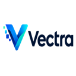

<p align="center"></p>

<h1 align="center">Vectra</h1>

<p align="center">VS Code와 웹에서 사용하는 로컬 중심 AI 작업 공간입니다.</p>

<p align="center"><a href="../../README.md">English</a></p>

## Vectra 소개

Vectra는 로컬 GGUF/Ollama 모델과 클라우드 AI를 모두 지원합니다. VS Code에서는 프로젝트를 이해하고 안전하게 코드 수정을 제안하며, 웹에서는 대화, 검색, 문서 분석, OCR, 차트와 파일 생성을 지원합니다.

## 프로젝트 구성

```text
apps/vscode-extension   VS Code 확장 프로그램
apps/web                웹 애플리케이션
packages/agent-core     공통 에이전트 기능
packages/local-runtime 로컬 모델 공통 기능
```

## 개발 시작

Node.js 22 이상이 필요합니다.

```sh
npm install
npm run build
npm test
```

- [VS Code 확장 프로그램](vscode-extension.md)
- [Vectra Web](web.md)

## 라이선스

Vectra는 독점 소프트웨어입니다. 허용되는 사용 범위는 [라이선스](../../LICENSE)에서 확인할 수 있습니다.
